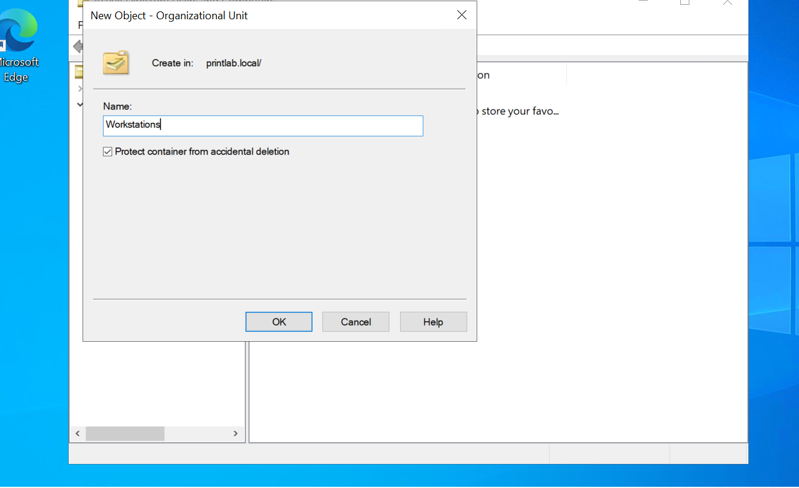
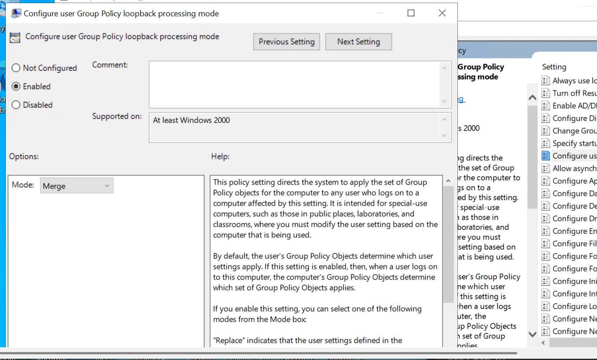

# Windows Server 2022 – Print Server & Group Policy Lab

## Project Overview

This project demonstrates the deployment and configuration of a Windows Server 2022 Print Server integrated with Active Directory Domain Services (AD DS), DNS, and Group Policy in a Microsoft Azure environment.

The objective was to build a two-server lab environment, configure a shared printer, join a client computer to a domain, and use Group Policy Preferences to automatically deploy the shared printer to a domain user.

This project provided hands-on experience with Windows Server administration, Active Directory, DNS configuration, printer sharing, Group Policy management, and client-side troubleshooting.

## Lab Environment

| Component | Configuration |
|---|---|
| Cloud Platform | Microsoft Azure |
| Operating System | Windows Server 2022 Datacenter: Azure Edition |
| Server 1 | SERVER01 |
| Server 2 | CLIENT01 |
| Domain | printlab.local |
| Domain Controller | SERVER01 |
| DNS Server | SERVER01 |
| Print Server | SERVER01 |
| Client Computer | CLIENT01 |
| SERVER01 Private IP | 10.0.0.4 |
| CLIENT01 Private IP | 10.0.0.5 |
| Printer Name | Office-Printer-01 |
| Printer Share | Office-Printer-01 |
| Organizational Unit | Workstations |
| Group Policy Object | Deploy Office Printer |

## Network Architecture

The lab consists of two virtual machines hosted in the same Azure virtual network and subnet.

- **SERVER01:** Configured as the Domain Controller, DNS Server, and Print Server.
- **CLIENT01:** Configured as a domain-joined client computer.
- **Domain:** Both machines operate within the `printlab.local` domain.
- **DNS:** CLIENT01 uses SERVER01 for DNS resolution.
- **Printer Sharing:** CLIENT01 connects to the shared printer hosted on SERVER01.

## Technologies & Tools

- Microsoft Azure Virtual Machines
- Windows Server 2022
- Active Directory Domain Services (AD DS)
- Domain Name System (DNS)
- Group Policy Management Console (GPMC)
- Group Policy Preferences
- Print and Document Services
- Print Management
- Remote Desktop Protocol (RDP)
- Command Prompt (CMD)
- Windows Services
- Event Viewer

## Project Implementation

### 1. Azure Virtual Machine Deployment

Created two Windows Server 2022 virtual machines in Microsoft Azure.

- Deployed SERVER01 and CLIENT01.
- Placed both virtual machines in the same virtual network and subnet.
- Configured SERVER01 with a static private IP address of `10.0.0.4`.
- Verified network connectivity between the two virtual machines.

### 2. Print Server Installation and Configuration

Installed the Print and Document Services role on SERVER01.

- Installed the Print Server role through Server Manager.
- Created a shared folder at `C:\PrintLab`.
- Added a printer using the Generic / Text Only driver.
- Configured a local file-backed printer port at `C:\PrintLab\PrintOutput.txt`.
- Named and shared the printer as `Office-Printer-01`.
- Connected to the shared printer from CLIENT01 using its UNC path.

**Printer Share Path:**

`\\10.0.0.4\Office-Printer-01`

### 3. Printer Connectivity and Testing

Verified that CLIENT01 could access and use the shared printer hosted on SERVER01.

- Connected to the shared printer using its UNC path.
- Verified that the printer appeared on CLIENT01.
- Printed a test document from Notepad.
- Confirmed that the output was written to the print output file on SERVER01.
- Restarted the Print Spooler service.
- Practiced pausing, reviewing, canceling, and resuming print jobs.

### 4. Active Directory Domain Services

Installed and configured Active Directory Domain Services on SERVER01.

- Installed the AD DS role.
- Created a new Active Directory forest named `printlab.local`.
- Promoted SERVER01 to a Domain Controller.
- Configured DNS during domain controller promotion.
- Verified that SERVER01 successfully operated as the Primary Domain Controller.
- Tested DNS name resolution using `nslookup`.

### 5. Client DNS Configuration and Domain Join

Configured CLIENT01 to communicate with the new domain.

- Updated CLIENT01's DNS server address to `10.0.0.4`.
- Verified DNS resolution for `printlab.local`.
- Joined CLIENT01 to the `printlab.local` domain.
- Authenticated using the domain Administrator account.
- Restarted CLIENT01 to complete the domain join.

### 6. Active Directory Organizational Unit

Created an Organizational Unit to organize domain workstations.

- Created an OU named `Workstations`.
- Located the CLIENT01 computer object in Active Directory Users and Computers.
- Moved CLIENT01 into the `Workstations` OU.

### 7. Group Policy Management

Created and configured a Group Policy Object to deploy the shared printer.

- Opened Group Policy Management Console (GPMC).
- Created a GPO named `Deploy Office Printer`.
- Linked the GPO to the `Workstations` OU.
- Configured a Shared Printer preference under:

  `User Configuration → Preferences → Control Panel Settings → Printers`

- Set the printer preference action to **Update**.
- Configured the shared printer path:

  `\\SERVER01\Office-Printer-01`

### 8. Group Policy Loopback Processing

Enabled Group Policy loopback processing to apply user policy settings based on the computer's organizational unit.

Configured the following policy:

`Computer Configuration → Policies → Administrative Templates → System → Group Policy`

- Enabled **Configure user Group Policy loopback processing mode**.
- Selected **Merge** mode.
- This allows normal user policies to be combined with user settings applied through the computer's OU.

### 9. Group Policy Deployment and Verification

Tested the printer deployment using a domain user account.

- Created a domain user named `labuser` in Active Directory.
- Added the domain user to CLIENT01's Remote Desktop Users group to allow remote sign-in.
- Logged into CLIENT01 using `PRINTLAB\labuser`.
- Ran `gpupdate /force` to refresh Group Policy.
- Verified that the `Office-Printer-01` shared printer appeared automatically on CLIENT01.
- Confirmed successful deployment through Group Policy Preferences.

## Troubleshooting & Validation

During the project, I worked through several configuration and connectivity issues.

| Issue | Resolution |
|---|---|
| CLIENT01 initially used Azure DNS | Configured CLIENT01 to use SERVER01 (`10.0.0.4`) for DNS |
| CLIENT01 could not initially access the printer share | Used the correct UNC path to connect to the shared printer |
| Group Policy Management Console was unavailable | Installed or enabled the Group Policy Management feature |
| Shared Printer option was not available under Computer Configuration | Configured the printer preference under User Configuration |
| Printer did not automatically appear for the local administrator | Tested with a domain user because the printer deployment was configured as a user-based preference |
| Domain user could not initially sign in remotely | Added the domain user to the Remote Desktop Users group on CLIENT01 |

## Skills Demonstrated

- Windows Server 2022 administration
- Microsoft Azure virtual machine deployment
- Active Directory Domain Services configuration
- Domain controller promotion and management
- DNS configuration and troubleshooting
- Domain joining and computer account management
- Organizational Unit creation and management
- Group Policy Object creation and configuration
- Group Policy Preferences
- Group Policy loopback processing
- Print Server installation and management
- Shared printer deployment
- Print Spooler troubleshooting
- Remote Desktop access management
- Network connectivity troubleshooting
- Command-line administration

## Screenshots

The following screenshots document the configuration, deployment, testing, and troubleshooting steps completed throughout this lab.

### 1. Azure Infrastructure and Networking

### 2. Active Directory and Domain Controller Configuration

### 3. Print Server Installation and Configuration

### 4. Printer Connectivity and Troubleshooting

### 5. Group Policy Printer Deployment

## Important Lab Notes

- The printer uses a simulated file-backed local port rather than a physical network printer. Print output is written to `C:\PrintLab\PrintOutput.txt`.
- The client machine runs Windows Server 2022 rather than Windows 10 or Windows 11.
- Active Directory Domain Services, DNS, and Print Server roles were combined on SERVER01 for this learning environment. A production environment would typically use a more separated architecture.
- Printer deployment was verified with a domain user account. The user-based Group Policy Preference was not intended to deploy the printer to unrelated local accounts.

## Conclusion

Successfully built a two-server Windows Server 2022 lab environment in Microsoft Azure, configured Active Directory and DNS, deployed a shared printer, and implemented Group Policy Preferences to automatically connect the printer for a domain user.

This project provided practical experience with common Windows Server administration tasks and troubleshooting scenarios relevant to entry-level IT support, help desk, and systems administration roles.
